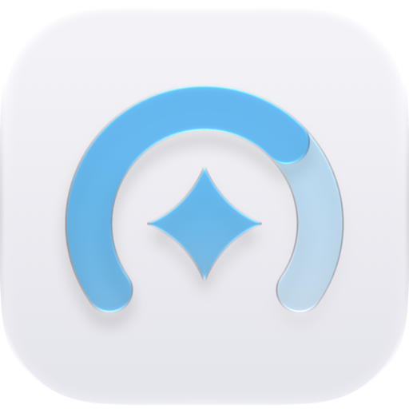
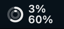
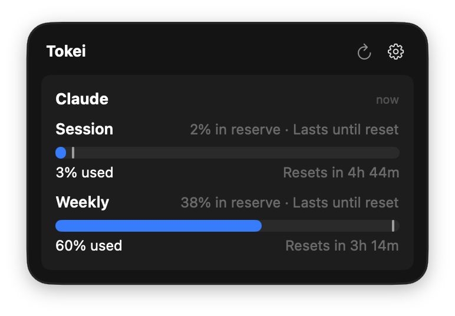
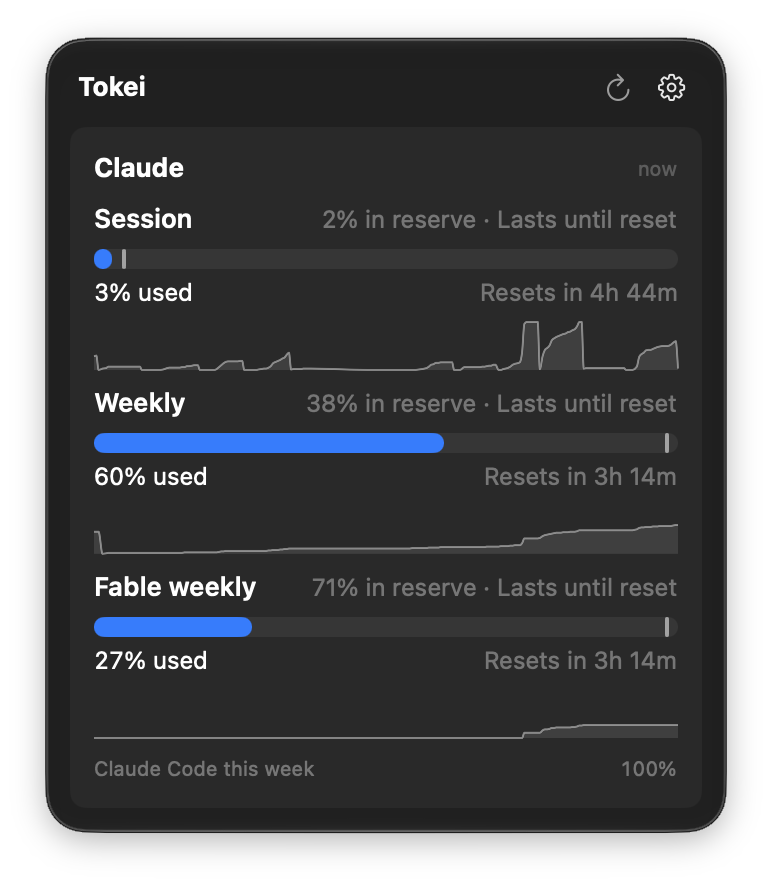
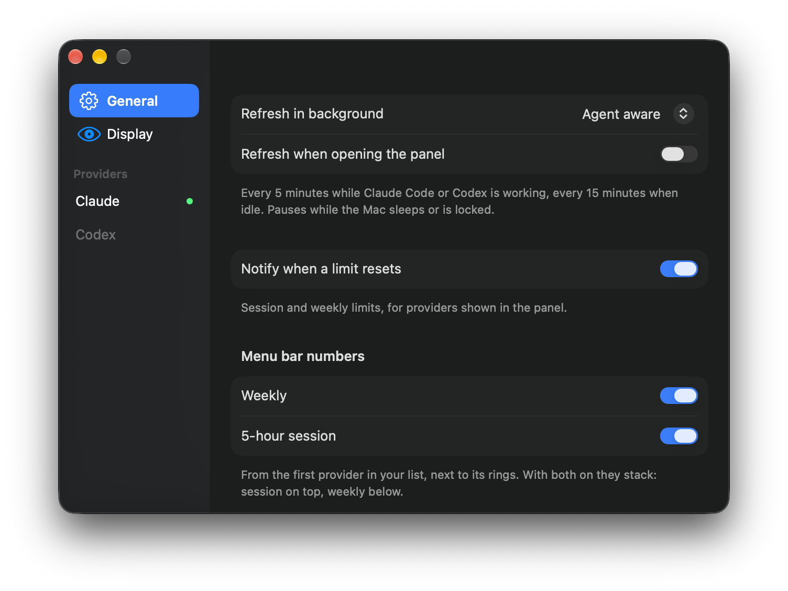

<p align="center">
  
</p>

<h1 align="center">Tokei</h1>

<p align="center">
  Your Claude and Codex plan limits, in the menu bar.<br>
  What's used, when it resets, and whether your pace lasts until then.
</p>

<p align="center">
  <a href="https://github.com/wormadev/Tokei/releases/latest"></a>
  
</p>

<p align="center">
  
</p>

## Install

**Homebrew**

```sh
brew install --cask wormadev/tap/tokei
```

**Download**

Get [Tokei.dmg](https://github.com/wormadev/Tokei/releases/latest/download/Tokei.dmg) and drag Tokei to Applications. Tokei isn't notarized by Apple yet, so the first launch needs one extra step: open Tokei, then go to **System Settings > Privacy & Security** and click **Open Anyway**. (The Homebrew cask clears that flag for you.)

Requires macOS 26 or later. Updates install from the app: right-click the menu bar icon > **Check for Updates…**.

## Getting started

Sign in to [Claude Code](https://docs.anthropic.com/en/docs/claude-code) or [Codex](https://github.com/openai/codex) once, if you haven't. Tokei reads the sign-in they already saved; there is nothing to configure.

- **Click** the menu bar icon for the panel. **Right-click** for Refresh, Settings, Check for Updates and Quit.
- Claude Code may keep its sign-in in the Keychain. Tokei reads it only after you click **Connect** in Settings > Claude.

## Features

| | |
|---|---|
|  | **Always in view.** Two rings and two numbers: the 5-hour session on top, the week below. |
|  | **Pace, not just percent.** Usage compared to an even spread over the window: "10% in reserve · Lasts until reset", or when it runs out. |
|  | **Details on demand.** 7-day history, per-model limits, spend and service outages. All opt-in under Settings > Display. |
|  | **Quiet by design.** Every 5 minutes while Claude Code or Codex is working, every 15 when idle, paused while the Mac sleeps or is locked. No Keychain prompts in the background. |

Also: reset notifications, used or remaining counting, provider order, launch at login, and numbers that show instantly at launch and never blank out while refreshing.

## Privacy

Tokei has no server, no account and no analytics. Your Claude token goes only to `api.anthropic.com`, your Codex token only to `chatgpt.com`. It also reads public status pages (`status.claude.com`, `status.openai.com`) and checks GitHub for updates. Tokei never refreshes your tokens, so it can't log the CLIs out. Usage and settings stay on your Mac.

## Build from source

Needs Xcode 26 and [XcodeGen](https://github.com/yonaskolb/XcodeGen).

```sh
xcodegen generate
xcodebuild -project Tokei.xcodeproj -scheme Tokei -configuration Debug -derivedDataPath build build
open build/Build/Products/Debug/Tokei.app
```

Tests: `xcodebuild -project Tokei.xcodeproj -scheme Tokei -derivedDataPath build test`. Debug builds never check for updates.

## Repository

- `Sources`, `Tests`: the app
- `site`: the website (static HTML)
- `video`: the promo video ([Remotion](https://www.remotion.dev)); `cd video && bun install && bunx remotion render Promo out/tokei.mp4`
- `scripts/release.sh`: builds the DMG and the signed update feed; `--publish` creates the GitHub release and bumps the [Homebrew cask](https://github.com/wormadev/homebrew-tap)

Endpoint knowledge comes from [CodexBar](https://github.com/steipete/CodexBar) (MIT); no code is copied.
